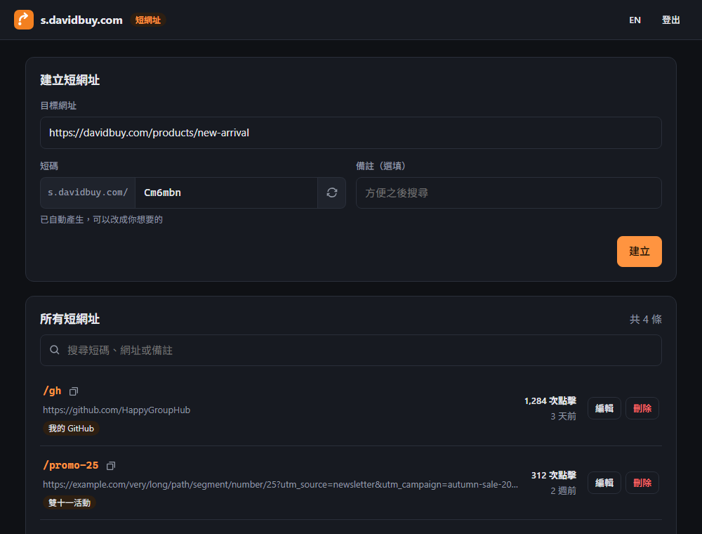

# short-url-cfworker

English | [繁體中文](README.md)

A personal URL shortener that runs on Cloudflare Workers. Links are stored in a Cloudflare D1 database and managed from a web admin page. Everything fits in Cloudflare's free plan, so you don't need a server of your own.



## Features

- `your-domain/slug` redirects to the destination with a 302, and any query string (such as `?utm_source=...`) is passed along
- Create, search, edit and delete links from the admin page at `/admin`, with an optional note on each
- A random slug is filled in as you type the destination URL. Keep it, or change it to your own (any language), now or later
- Click counts for every link
- Password login. Each IP gets 5 tries per 15 minutes, and once you're logged in, the browser stays logged in until you log out
- Traditional Chinese and English UI, light and dark themes, works on phones

## Deploy

There are two ways to deploy. Pick one:

- [One-click deploy](#one-click-deploy-recommended): everything happens in the browser and there's nothing to install. Right for most people.
- [Manual deploy](#manual-deploy): deploy from the command line. Right if you want to change the code on your own machine.

You need a [Cloudflare account](https://dash.cloudflare.com/sign-up) (free) and a GitHub account.

### One-click deploy (recommended)

The button does the following for you:

- Copies this project into a new repo on your GitHub account. It's a copy, not a fork, so you don't need to fork anything first.
- Creates a D1 database and connects it to the Worker.
- Builds and deploys the Worker.
- Redeploys automatically whenever you push to that repo later.

Here is what you do.

**1. Click the button**

[](https://deploy.workers.cloudflare.com/?url=https://github.com/HappyGroupHub/short-url-cfworker)

Log in to Cloudflare if you aren't already.

**2. Connect GitHub**

When asked to connect a Git account, choose GitHub and authorize Cloudflare. If you've connected it before, this step is skipped.

**3. Check the settings**

Most fields are already filled in:

| Field | What to do |
|---|---|
| Git account and repository name | Pick the account to create the repo under. The default name is fine. |
| Worker name (Project name) | Defaults to `short-url` and appears in the URL. Change it if you like. |
| D1 database | Keep the default; Cloudflare creates a new one. |
| `ADMIN_PASSWORD` | Your admin password. Use a long, random string. |
| Build / deploy commands | Keep the defaults. |

**4. Deploy**

Click **Create and deploy** and wait for the build to finish, usually a minute or two.

**5. Log in**

When it's done you'll see the Worker's URL, something like `https://short-url.your-subdomain.workers.dev`. Add `/admin` to it, open it, and log in with the password you just set. You can start creating links.

To use your own domain, see [Use your own domain](#use-your-own-domain).

### Manual deploy

Requires [Node.js](https://nodejs.org/) 20 or later and Git.

**1. Download the project and install dependencies**

```bash
git clone https://github.com/HappyGroupHub/short-url-cfworker.git
cd short-url-cfworker
npm install
```

**2. Log in to Cloudflare**

```bash
npx wrangler login
```

A browser window opens on Cloudflare's authorization page. Click Allow.

**3. Deploy**

```bash
npm run deploy
```

On the first deploy, Wrangler asks whether to create a new D1 database. Choose to create one. Tables are created automatically on the first request, so there are no database commands to run.

**4. Set the admin password**

```bash
npx wrangler secret put ADMIN_PASSWORD
```

Type your password and press Enter.

**5. Log in**

Open the URL printed by the deploy step, add `/admin`, and log in with that password.

## Use your own domain

The domain must already be on Cloudflare (Cloudflare manages its DNS).

1. Open the [Cloudflare dashboard](https://dash.cloudflare.com/), choose **Workers & Pages** on the left, and click your Worker.
2. Go to **Settings**, find **Domains & Routes**, and click **Add**.
3. Choose **Custom domain**, enter the domain, for example `s.example.com`, and click **Add domain**.

It works once the certificate is issued, usually within a few minutes. Open the admin page from your own domain from then on, so the links you copy use that domain too.

## Configuration

| Name | What it does | How to change it |
|---|---|---|
| `ADMIN_PASSWORD` | Admin password (required). Changing it logs out every device. | Cloudflare dashboard → your Worker → **Settings** → **Variables and Secrets**, edit `ADMIN_PASSWORD` |
| `HOME_URL` | Where to send visitors who open the bare domain, such as your main website. Empty shows a simple page. | Edit `vars.HOME_URL` in `wrangler.jsonc` in your repo, then push |

Change `HOME_URL` in `wrangler.jsonc`, not in the dashboard. Every deploy replaces dashboard values with what's in the config file.

## Updating

The repo created by the button is a copy, so it doesn't follow this project automatically. To pull in updates, run this in your repo's folder:

```bash
git remote add upstream https://github.com/HappyGroupHub/short-url-cfworker.git
git pull upstream main
git push
```

You only need the first line once. Cloudflare redeploys after the push. If `wrangler.jsonc` conflicts, keep your own settings.

## Is the free plan enough?

For personal use, almost certainly. The Workers free plan allows 100,000 requests a day; D1 allows 5 million rows read and 100,000 rows written a day.

Each click reads 1 row and writes 1 row (the click counter). An admin search reads about as many rows as you have links. So the real limit is the Workers cap of 100,000 requests a day, close to 100,000 clicks. Limits reset daily at 00:00 UTC.

## Notes

- Redirects use 302, not 301. Browsers cache a 301 permanently, which would break changing a link's target and counting clicks.
- `admin`, `api`, `favicon.svg` and `robots.txt` are reserved and can't be used as slugs.
- Slugs may contain letters (any language), digits and `- _ . ~`, can't start with `.`, and are at most 64 characters. Random slugs avoid look-alike characters such as `0 O 1 l I`.
- Renaming a slug makes the old short link stop working right away, including anywhere you already shared it.
- `HEAD` requests aren't counted as clicks. They usually come from chat apps building link previews.
- To change the icon, replace `public/favicon.svg`.

## Moving from Url-Shorten-Worker

If you used [Url-Shorten-Worker](https://github.com/crazypeace/Url-Shorten-Worker) (links stored in KV), you can import all your old links, and every link you already shared keeps working. See [docs/migrate-from-kv.en.md](docs/migrate-from-kv.en.md).

## Local development

```bash
cp .dev.vars.example .dev.vars   # then set ADMIN_PASSWORD in it
npm run dev                      # http://localhost:8787/admin/
npm test                         # unit tests
npm run typecheck
```

## Project layout

```
src/
  index.ts       redirects and routing
  api.ts         admin API (/api/*)
  auth.ts        password and login sessions
  rate-limit.ts  login attempt limit
  db.ts          D1 schema and queries
  links.ts       slug and URL validation
  import-kv.ts   import from KV
  pages.ts       home and 404 pages
public/
  admin/         admin page (plain HTML / CSS / JS, no build step)
test/            unit tests (Vitest)
```

## License

[MIT](LICENSE)
